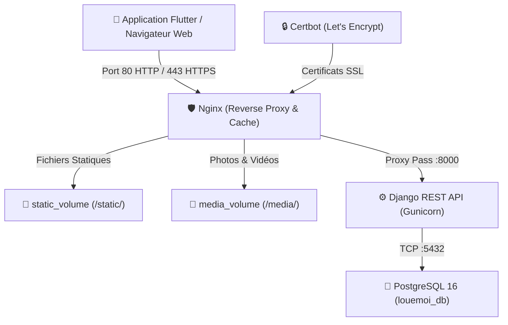

# 🚀 Guide de Déploiement Complet — LoueMoi

Ce guide explique étape par étape comment déployer l'architecture backend de **LoueMoi** sur un serveur VPS distant (Ubuntu, Debian, CentOS, etc.) avec **Docker**, **Nginx**, **Gunicorn**, **PostgreSQL** et un certificat SSL **Let's Encrypt (HTTPS)**.

---

## 📋 Architecture Déployée



---

## 1. Préparation du Domaine (DNS)

Avant de lancer le script de déploiement avec SSL :
1. Rendez-vous sur votre registraire de domaine (OVH, Hostinger, Cloudflare, Namecheap...).
2. Ajoutez un enregistrement **A** :
   - **Type** : `A`
   - **Nom / Hôte** : `api` (ou `@` pour le domaine racine)
   - **Valeur** : `IP_DE_VOTRE_SERVEUR` (ex: `198.51.100.42`)
   - **TTL** : Automatique ou 300 secondes

---

## 2. Commandes pour Récupérer le Projet sur le Serveur

### Méthode A : Via Git (Recommandée)

Connectez-vous à votre serveur via SSH :
```bash
ssh root@IP_DE_VOTRE_SERVEUR
```

Puis clonez le projet dans `/var/www/louemoi` :
```bash
# 1. Aller dans le dossier des applications
mkdir -p /var/www && cd /var/www

# 2. Cloner le dépôt
git clone <URL_DE_VOTRE_DEPOT_GIT> louemoi

# 3. Entrer dans le dossier
cd louemoi
```

---

### Méthode B : Transfert Direct depuis votre Machine Locale (si pas de Git distant)

Depuis votre ordinateur (invite PowerShell ou terminal local) :

```powershell
# Depuis la racine de LoueMoi sur votre machine locale :
scp -r backend nginx docker-compose.yml deploy.sh .env.example root@IP_DE_VOTRE_SERVEUR:/var/www/louemoi/
```

Ou avec `rsync` (si disponible) :
```bash
rsync -avz --exclude='.dart_tool' --exclude='build' --exclude='android' --exclude='ios' ./ root@IP_DE_VOTRE_SERVEUR:/var/www/louemoi/
```

---

## 3. Lancement du Script de Déploiement

Sur le serveur :

```bash
cd /var/www/louemoi

# Nettoyer les retours à la ligne Windows (si transféré depuis Windows)
sed -i 's/\r$//' deploy.sh

# Rendre le script exécutable
chmod +x deploy.sh

# Lancer le déploiement interactif
./deploy.sh
```

### Ce que fait le script automatiquement :
1. ✅ **Détecte votre OS** et installe Docker, Docker Compose, Git et Curl si absents.
2. 🛡️ **Configure le pare-feu UFW** pour ouvrir les ports `22` (SSH), `80` (HTTP) et `443` (HTTPS).
3. ⚙️ **Configure le fichier `.env`** (domaine, email SSL, clé secrète Django, mot de passe base de données, etc.).
4. 🛑 **Arrête temporairement tout service Nginx / Apache occupant le port 80** pour permettre à Certbot d'opérer en mode `standalone`.
5. 🔒 **Génère le certificat SSL Let's Encrypt** automatiquement.
6. 🏗️ **Construit et lance les conteneurs Docker** (`louemoi_db`, `louemoi_backend`, `louemoi_nginx`, `louemoi_certbot`).
7. 🗄️ **Exécute les migrations Django** et collecte les fichiers statiques (`collectstatic`).
8. 👤 **Crée le compte administrateur** et charge les données de démonstration (`seed_demo_data`).
9. 🔄 **Installe une tâche Cron** pour renouveler automatiquement le certificat SSL chaque semaine.
10. 🩺 **Exécute un Health Check** pour confirmer que l'API et le proxy répondent avec succès.

---

## 4. Commandes Utiles pour la Maintenance

Toutes les opérations courantes peuvent être effectuées via `./deploy.sh` :

| Action | Commande |
|---|---|
| **Voir l'état de la stack** | `./deploy.sh --status` |
| **Voir les logs en direct** | `./deploy.sh --logs` (ou `./deploy.sh --logs web`) |
| **Mettre à jour l'application** | `./deploy.sh --update` |
| **Créer une sauvegarde (DB + Médias)** | `./deploy.sh --backup` |
| **Restaurer une sauvegarde** | `./deploy.sh --restore backups/fichier.tar.gz` |
| **Renouveler ou forcer le SSL** | `./deploy.sh --ssl` |
| **Redémarrer les conteneurs** | `./deploy.sh --restart` |
| **Arrêter les conteneurs** | `./deploy.sh --stop` |
| **Nettoyer le cache Docker** | `./deploy.sh --clean` |

---

## 5. Connecter l'Application Flutter au Serveur

Une fois déployé avec succès, configurez l'application mobile Flutter pour cibler votre nouveau domaine sécurisé :

1. Ouvrez `assets/env/.env.production` (ou passez le paramètre au build) :
   ```env
   API_BASE_URL=https://api.votredomaine.com
   USE_MOCK_DATA=false
   ```
2. Compilez l'application Flutter en mode release :
   ```bash
   flutter build apk --release --dart-define=ENV=production
   # ou pour iOS :
   flutter build ipa --release --dart-define=ENV=production
   ```
